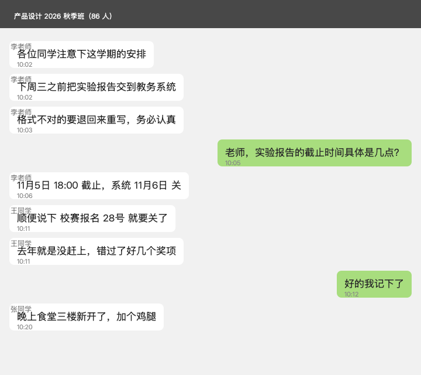

# DDLShot

> 截屏 → 理解内容 → 自动写进 macOS 系统「提醒事项」

群里一句「下周三之前把实验报告交了」、邮件里一行 Deadline、通知栏一张排班表截图 ——
按一次 `⌃⌥D`，这些东西就变成系统「提醒事项」里带截止时间的待办。

* **不进相册、不留截图**：截屏在进程内完成（ScreenCaptureKit），OCR 走系统 Vision，**默认不联网**
* **默认走本地规则引擎**：不配任何 key 也能用；配了 key 才启用大模型引擎，一次抽出全部 DDL
* **模型不挑家**：MiniMax / DeepSeek / OpenAI / 通义千问 / 智谱 / Kimi / 豆包 / 硅基流动 / Gemini / Ollama / 任意 OpenAI 兼容接口
* **写进真正的系统提醒事项**（EventKit），不是自建待办列表

---

## 目录

- [效果](#效果)
- [快速开始](#快速开始)
- [权限](#权限)
- [两种引擎](#两种引擎)
- [配置大模型（支持多家供应商）](#配置大模型支持多家供应商)
- [全局热键 ⌃⌥D](#全局热键-⌃⌥d)
- [四种入口](#四种入口)
- [命令行](#命令行)
- [日期识别范围](#日期识别范围)
- [目录结构](#目录结构)
- [九个技术坑](#九个技术坑)
- [已知限制](#已知限制)
- [同类工具](#同类工具)
- [License](#license)

---

## 效果

拿一张模拟群聊的截图（[`Resources/samples/chat_sample.png`](Resources/samples/chat_sample.png)），
里面混着闲聊、两件不同的事、两处口语化日期：



**规则引擎**在这个图上的表现：

```
1. 辛 把实验报告交到教务系统
   截止：2026年10月28日 星期三 09:00   [识别自「周三」]
```

- 任务名里混进了 OCR 认错的「辛」
- **日期完全错了** —— 真截止是「11月5日 18:00」，被 OCR 认成「要养月5日」→ 没匹配上；
  引擎反而抓了另一条消息里的「28号」
- 「校赛报名 28号」这条直接丢了
- 「晚上食堂三楼新开了」这种闲聊被当成了候选

**大模型引擎**对同一张图的输出：

```
1. 提交实验报告
   截止：2026年11月5日 星期四 18:00   [识别自「11月5日 18:00 截止」]   置信度：high
2. 报名校赛
   截止：2026年10月28日 星期三 09:00   [识别自「28号就要关了」]        置信度：medium
```

| | 规则引擎 | 大模型引擎 |
|---|---|---|
| 识别条数 | 1 条（漏掉校赛报名） | **2 条**（都识别对了） |
| 交实验报告 | 2026-**10-28** ✗（抓错行） | 2026-**11-05 18:00** ✓ |
| 校赛报名 | 漏 | 2026-10-28 ✓ |
| 任务名 | 「**辛** 把实验报告…」（OCR 错字混进标题） | 提交实验报告 ✓ |
| 噪声 | 「食堂三楼新开了」被当候选 | 食堂、「去年没赶上」都正确忽略 ✓ |
| 泛指 vs 确切时间 | 分不清 | **分得清**：「下周三之前」是泛指，「11月5日 18:00 截止」才是真截止 |

大模型能区分**「下周三之前」是泛指**、**「11月5日 18:00 截止」才是真截止**、**「28号」属于另一件事**，
还能过滤掉食堂和「去年没赶上」这类噪声 —— 这是正则做不到的。

---

## 快速开始

```bash
git clone <这个仓库> DDLShot && cd DDLShot

./Tools/make_signing_cert.sh     # 1. 为你这台机器生成签名证书（详见下文「为什么要自签证书」）
./build.sh                       # 2. 编译 + 三套自检
./install.sh                     # 3. 安装到 ~/Applications、注册开机自启、启动
```

编译需要 **Xcode Command Line Tools**（`xcode-select --install`）和 **Swift 6.3+**，最低支持 macOS 14。

### 为什么要自签证书

macOS 对 ad-hoc 签名的 app，designated requirement 只能是 `cdhash`。
代码一改 cdhash 就变 → 系统里那条「屏幕录制 / 提醒事项」的授权记录**随即失效**，
于是每次截屏都要重新问你一遍「想要录制此电脑的屏幕」。

证书签名的 DR 绑定的是**证书本身**：

```
designated => identifier "app.ddlshot.mac" and certificate root = H"…"
```

重编译后 cdhash 变了，但这行 DR 一模一样 → 系统直接复用旧授权，**再也不弹**。

`Tools/make_signing_cert.sh` 会在你的登录钥匙串里生成一张自签名证书，并把指纹写进
`~/.config/ddlshot/signing/cert.sha1`；`build.sh` 自动读取它来签名。
**每人一张、只在本机使用**，脚本是幂等的：钥匙串里已经有同名证书就直接复用，不会打断你已有的授权。

> 生成证书有两个坑，脚本里都处理了：
> ① 证书必须带 `extendedKeyUsage=codeSigning`，否则 macOS 不认它是代码签名身份；
> ② PKCS#12 必须用 `openssl pkcs12 -export -legacy`（OpenSSL 3 的新算法 macOS 解析不了）。

### Bundle ID 是可以改的

不同机器、不同 fork 用不同的 bundle id，避免 TCC 授权串味。优先级：

1. 环境变量 `DDLSHOT_BUNDLE_ID`
2. `~/.config/ddlshot/bundle_id`（`install.sh` 会自动写这个文件）
3. 默认 `app.ddlshot.mac`

```bash
echo "com.yourname.ddlshot" > ~/.config/ddlshot/bundle_id
```

> ⚠️ **换了 bundle id 就要重新授权一次** —— 系统是按 bundle id 记录「提醒事项 / 屏幕录制」的。
> 反过来说，只要你不动它，重编译多少次权限都不会失效。

---

## 权限

首次使用会弹窗，请点「允许」：

| 权限 | 用途 | 位置 |
|---|---|---|
| 提醒事项 | 写入 DDL 清单 | 系统设置 → 隐私与安全性 → **提醒事项** |
| 录屏与系统录音 | 截取窗口/屏幕画面 | 系统设置 → 隐私与安全性 → **录屏与系统录音**（macOS 14 及以前叫「屏幕录制」） |
| 辅助功能（可选） | 全局热键的第二条监听通道 | 系统设置 → 隐私与安全性 → **辅助功能** |

随时自检，不用等它报错：

```bash
~/Applications/DDLShot.app/Contents/MacOS/DDLShot --status
```

```
提醒事项权限：完全访问 ✅
可见清单　：提醒事项、DDL
屏幕录制权限：已授权 ✅
大模型：已配置（MiniMax · MiniMax-M3.1-Flash @ https://api.minimax.cn/anthropic/v1）
```

想重新授权：

```bash
# 方式一：系统设置里手动开（最稳）
open "x-apple.systempreferences:com.apple.preference.security?Privacy_Reminders"

# 方式二：重置记录，让系统重新弹窗（把 id 换成你自己的）
tccutil reset All app.ddlshot.mac
```

### 出错了怎么读（重要）

失败原因会**分级**，每种失败直接告诉你真实原因，不会统统报成「没有设置权限」：

| 你看到的提示 | 真实含义 | 该做什么 |
|---|---|---|
| `画面已经拿到了，但里面没有识别出带截止时间的待办` + `→ 这不是权限问题` | 截图成功、模型也读了，只是**这张图里确实没有带日期的 DDL** | 换一张有明确日期的截图；或先用 `--dry-run` 看模型读到了什么 |
| `抓取失败：…` + `→ 屏幕录制权限未授权` | 截屏这一步就被系统挡住了 | 系统设置 → 隐私与安全性 → 录屏与系统录音 → 打开 DDLShot |
| `写入提醒事项失败：…` + `→ 提醒事项权限不足` | 识别成功，**写到「提醒事项」**这一步被拒 | 系统设置 → 隐私与安全性 → 提醒事项 → 打开 DDLShot |
| `大模型配置不完整：…` | 配置文件缺字段 | 编辑 `~/.config/ddlshot/config.json` |

---

## 两种引擎

DDLShot 有两套解析引擎。默认是 `--engine auto`：**配置了大模型 key 就走大模型，没配就自动回落到本地规则**，
也可以用 `--engine rule` / `--engine llm` 强制指定。

| | `--engine rule` | `--engine llm` |
|---|---|---|
| 原理 | 正则 + 关键词行打分 | 把截图/文字交给云端大模型，让它**理解**内容 |
| 速度 | 亚秒级 | 2–6 秒（网络往返 + 模型思考） |
| 联网 | 不需要 | 需要 |
| 多条任务 | ❌ 只能取一条 | ✅ 一次抽出全部 |
| 抗 OCR 错字 | ❌ 错一个字就崩 | ✅ 靠上下文推断 |
| 适合 | 结构规整的清单 | 群聊、邮件、通知、截图里的零散 DDL |

---

## 配置大模型（支持多家供应商）

编辑 `~/.config/ddlshot/config.json`（`install.sh` 会在你第一次安装时生成模板）：

```json
{
  "llm": {
    "provider": "minimax",
    "api_key": "把你的 API Key 填在这里",
    "model": "",
    "base_url": "",
    "protocol": "",
    "timeout": 120,
    "default_hour": 9,
    "fallback_to_text": true
  },
  "hotkey": "ctrl+alt+d"
}
```

只要填 `provider` + `api_key`，`base_url` / `model` / `protocol` 会**自动补全**；
自己显式写了就以你写的为准。

### 内置供应商预设

| provider | 说明 | 默认协议 |
|---|---|---|
| `minimax` | MiniMax（Anthropic 兼容） | anthropic |
| `minimax-openai` | MiniMax（OpenAI 兼容） | openai |
| `deepseek` | DeepSeek | openai |
| `openai` | OpenAI | openai |
| `qwen` | 阿里云百炼（通义千问） | openai |
| `zhipu` | 智谱 GLM | openai |
| `moonshot` | 月之暗面 Kimi | openai |
| `doubao` | 火山引擎方舟（豆包） | openai |
| `siliconflow` | 硅基流动 SiliconFlow | openai |
| `gemini` | Google Gemini | openai |
| `ollama` | 本地 Ollama | openai |
| `custom` | 自定义，自己填 `base_url` | openai |

列出全部预设：

```bash
~/Applications/DDLShot.app/Contents/MacOS/DDLShot --list-providers
```

> 协议只有 `openai` 和 `anthropic` 两种，但**任何 OpenAI 兼容的接口**都能用 —— 自建网关、
> 代理、本地 vLLM，填 `custom` + `base_url` 即可。

### 关于「送什么给模型」

默认**先把原图送给模型**（视觉模型最准，排班表/表格也能读），
如果模型不支持图片或调用失败，**自动降级**成本机 Vision OCR 的文本再送一次。
只想送文本可以用 `--llm-text`。

Prompt 里除了要求输出 JSON 数组，还有几条关键硬约束（都是实测踩出来的）：

- **一条任务必须能指出截止时间线索**（截止/前/之前/要/得/记得/关上…），否则不输出
- **吃饭约饭、闲聊玩笑、别人已完成的事**一律不输出
- **普通时间词不算截止时间**（「晚上食堂新开了」里的「晚上」不算）
- **省略月份按当前月份**（「28号」→ 10-28，除非该日号已过）
- **省略年份按当前年份**，已过则顺延到明年
- 标题里不保留「截止 / DDL / 前」这类标记词
- 每条附 `due_text`（原文里的时间短语）和 `confidence`，方便你一眼核对

### 代码层的兜底（模型也会犯错）

| 兜底 | 处理的问题 |
|---|---|
| **去重** | 模型偶尔把同一条任务吐两遍（甚至两条日期还不一样）→ 标题归一化后相同、或尾部 3 字互相包含就判为同一件，**保留 due_text 更具体的那次**。不同任务同一天不会被误合并。 |
| **容错 JSON** | 模型返回带 ```json 包裹、前后有废话、或者 content 本身是 JSON 字符串 → 自动剥壳再解析 |
| **剥 think 标签** | 推理型模型会把 `<think>…</think>` 塞进 content → 先剥掉再找 JSON |
| **降级链路** | 送图失败 → 自动改成本机 OCR 文本重试；大模型未配置 → 自动回落本地规则引擎 |
| **日期兜底** | 模型给的日期格式五花八门（`2026-11-05T18:00:00` / `2026-11-05` / `11-05`）→ 统一规整成绝对时间；缺失时间补默认 09:00 |

### key 不经过命令行

Swift 侧把 key 放进子进程的环境变量（`DDLSHOT_LLM_API_KEY`），
`ps` 看不到，命令行历史里也不会留下。配置文件本身在 `~/.config/ddlshot/config.json`，记得别提交进仓库。

---

## 全局热键 ⌃⌥D

按 `⌃⌥D` → 直接截取最前窗口并写入提醒事项。

热键走**三通道**，互为冗余，任意一条生效即可：

| 通道 | 需要权限 | 实测表现 |
|---|---|---|
| ① Carbon `RegisterEventHotKey` | 无 | 注册返回 0，但**macOS 26 上事件从不派发**，只能当兜底 |
| ② `NSEvent.addGlobalMonitorForEvents` / `addLocalMonitorForEvents` | 辅助功能 | 能收到大多数组合键，但**若被别的 App 用 local monitor 抢占就收不到** |
| ③ `CGEventTap`（session 级） | 辅助功能 / 输入监控 | 位于事件链**最上游，抢不走** —— 实测真正生效的就是它 |

> 通道 ③ 是主力，①② 是冗余。想知道当前到底是哪条在起作用，看诊断日志里的
> `按键到达[xxx]` 前缀 —— 每次触发都会打印 `🔥 触发：<来源>`。

授权状态会被**每 2 秒轮询一次**，`AXIsProcessTrusted()` 变 true 后**2 秒内自动生效，不用重启**。

热键触发会**立刻给可见反馈**（系统通知 + 控制面板提示），不会让人干等大模型那几秒。

### 诊断日志：按键到底有没有进到进程

「面板显示已注册」**不等于**「按键真的会触发」—— 注册成功只说明系统接受了请求。
所以 DDLShot 把热键链路上的每一步都写进日志：

```
~/Library/Logs/DDLShot/hotkey.log
```

里面会记录：组合键与键码、Carbon 注册返回码、三条通道各自是否装上，
以及**每一个带修饰键的按键到达了哪条通道**（keyCode、字符、修饰键）。
排查热键问题时先看这个文件。

在控制面板里可以：

- 点「**测试热键**」→ 10 秒自检窗口，按一次就知道通没通；失败时会直接显示日志路径
- 点「**辅助功能授权**」→ 一键唤起系统的辅助功能授权提示
- 看热键状态行：`热键：⌃⌥D（Carbon 已注册 · 监听 已启用 · tap 已启用）`

### 改热键

编辑 `~/.config/ddlshot/config.json`：

```json
{ "hotkey": "ctrl+alt+shift+p" }
```

支持的写法：`ctrl` / `alt` / `shift` / `cmd`（或 `command` / `option`）组合 `+` 一个字母或功能键。
例如 `ctrl+alt+d`、`cmd+shift+4`、`ctrl+f12`。

> 快捷指令 App 也能绑（动作选「执行 Shell 脚本」，内容 `~/Applications/DDLShot.app/Contents/MacOS/DDLShot --capture`，
> 再在「详细信息 → 键盘快捷键」里设成 `⌃⌥D`）。**两条路可以二选一，也可以并存**。

---

## 四种入口

DDLShot 是一个**常规 Mac App**：有 Dock 图标、有自己的菜单栏、控制面板能最小化。

| 入口 | 说明 |
|---|---|
| **Dock 图标** | 点一下就把控制面板叫出来（没有可见窗口时） |
| **双击 `DDLShot.app`** | 同上（访达里双击） |
| **`⌃⌥D`** | 不开面板，直接截取最前窗口并写入提醒事项 |
| **菜单栏状态项** | 部分 macOS 26 上系统不渲染第三方状态项，有就有，没有也不影响 |

**控制面板**（打开后就是它）：

| 按钮 | 等价命令 | 适合场景 |
|---|---|---|
| **截取最前窗口并记录 DDL**（蓝色主按钮） | `⌃⌥D` 或 `--capture` | 群里/邮件里的 DDL（最常用） |
| **手动框选区域并记录 DDL** | `--interactive` | 只截其中一块 |
| **解析剪贴板文字并记录 DDL** | `--clipboard` | 文字已经在剪贴板里，不用截屏 |
| （菜单里）截取整个屏幕并记录 DDL | `--screen` | 截图里有好几条 DDL |

> **手动框选**会铺一层全屏的截图让你在上面拖一个框（自己实现的进程内 overlay，不调用 `screencapture -i`，
> 所以不会触发 TCC 间接请求）。拖一下就行，**误点（框太小）会被当成取消**，按 Esc 也可以取消。

面板底部有一行结果提示（写没写成、写成什么），右上角「退出」可以退出 App。
**关掉面板窗口 App 仍在后台运行**，`⌃⌥D` 继续可用。

> 面板是**普通层级的窗口**（`level = .normal`），不是浮动窗口：
> 切到别的 App 之后它会老老实实退到后面，不会一直压在别人的窗口上面。
> 标题栏三个按钮齐全（关闭 / **最小化** / 缩放），最小化后收进 Dock；
> 也可以 `⌘M` 收起、`⌘W` 关闭。
> 位置会被记住（下次打开还在你上次放的地方）；
> 万一被拖到屏幕外，下次唤出时会自动夹回可见区域。

### 菜单栏

App 有自己的一套标准菜单（DDLShot / 编辑 / 窗口）：

| 菜单 | 内容 |
|---|---|
| DDLShot | 关于 DDLShot、权限自检…、隐藏 DDLShot（⌘H）、退出 DDLShot（⌘Q） |
| 编辑 | 撤销 / 重做 / 剪切 / 拷贝 / 粘贴 / 全选（⌘Z ⌘X ⌘C ⌘V ⌘A） |
| 窗口 | 收起（⌘M）、缩放、前置全部窗口 |

状态项右键菜单也做了精简，只留 6 项：

| 菜单项 | 说明 |
|---|---|
| 显示控制面板 | 把面板叫出来 |
| 截取整个屏幕并记录 DDL | 面板上唯一没有的能力 |
| 引擎：大模型（…） | 显示当前供应商/模型，点它能看全部可切换的 provider |
| 打开提醒事项 | 直接跳到系统「提醒事项」 |
| 关于 / 权限自检 | 版本号 + 权限状态 |
| 退出 DDLShot | 退出 |

（面板上已有的「截取最前窗口 / 手动框选 / 解析剪贴板」不再在菜单里重复出现。）

---

## 命令行

```bash
APP=~/Applications/DDLShot.app/Contents/MacOS/DDLShot

$APP --capture                   # 截最前窗口
$APP --screen                    # 截整屏
$APP --interactive               # 手动框选
$APP --clipboard                 # 解析剪贴板
$APP --text "截止11月5日 交报告" # 直接解析文本
$APP --image /path/pic.png       # 解析指定图片
$APP --dry-run                   # 只解析不写入（看解析对不对）
$APP --json                      # JSON 输出
$APP --init-list                 # 手动建 DDL 清单
$APP --status                    # 查权限和可见清单
$APP --list-providers            # 列出全部供应商预设
$APP --selftest                  # 解析器自检（14 个用例）
```

**调试用的环境变量**

| 变量 | 作用 |
|---|---|
| `DDLSHOT_KEEP_CAPTURE=1` | 保留截屏临时文件并打印路径（默认用完即删） |
| `DDLSHOT_TEST_REGION="x,y,w,h"` | 跳过交互框选，直接按 AppKit 全局坐标裁一块（自动化验证坐标换算用） |
| `DDLSHOT_BUNDLE_ID` | 覆盖 bundle id |
| `DDLSHOT_CERT_SHA1` | 覆盖签名证书指纹 |

---

## 日期识别范围

| 写法 | 例子 |
|---|---|
| 中文相对日 | 今天 / 今晚 / 明早 / 明晚 / 明天 / 后天 / 大后天 / 昨天 |
| 中文星期 | 周三 / 下周三 / 下下周五 / 本周五 / 星期二 / 礼拜四 |
| 中文月日 | 11月5日 / 11月5号 / 12月31日 |
| 中文时间 | 下午3点 / 上午10点 / 晚上8点 / 18:00 / 9:30 |
| 数字日期 | 2026-12-01 / 2026年12月1日 / 11/8 / 11-8 |
| 英文 | Deadline / Nov 5 / December 25th / today / tomorrow / next Monday / by Friday |

**任务名怎么取**：优先取**同一行**里去掉日期后的部分；该行只有日期没有内容时，往上/往下找最近的一行。
比较像任务名的词（截止/提交/完成/报名/面试/回复…）会加分。

**没写时间**默认当天 **09:00**；**只写日期不写年份**且已过 → 自动顺延到明年。

---

## 目录结构

```
DDLShot/
├── Sources/
│   ├── DDLShotKit.swift        # 解析器 / OCR / 截屏(ScreenCaptureKit) / EventKit / CLI
│   ├── LLMEngine.swift         # 供应商预设 + 调 Python 抽取器，批量写入
│   ├── HotKey.swift            # 热键组合解析 + Carbon 注册 + 辅助功能监听
│   ├── CropMath.swift          # 框选裁剪的坐标换算（纯函数，带单测）
│   ├── RegionSelector.swift    # 进程内手动框选（铺开截图 + 拖拽选区）
│   ├── ddlshot_llm.py          # 大模型抽取器（Python，OpenAI/Anthropic 双协议）
│   ├── main.swift              # 菜单栏 App + 控制面板 + 全局热键 + 入口
│   └── CShim/
│       ├── include/ddlshot_hotkey.h   # Carbon 热键的手工声明（见坑 #1）
│       └── module.modulemap
├── Resources/
│   ├── Info.plist              # 权限说明文案、Dock 图标开关（LSUIElement=false）、图标文件名
│   ├── ddlshot-config.example.json   # 大模型配置模板
│   ├── AppIcon-ai.png          # 备选图标（AI 生成版，见下方「图标」）
│   └── samples/                # 样例图（README 里那张群聊截图）
├── Tools/
│   ├── make_signing_cert.sh    # 为本机生成自签名代码签名证书
│   ├── make_release.sh         # 导出干净源码快照并打 zip
│   ├── make_icon.swift         # 用 SF Symbols 现画 App 图标（.icns）
│   ├── mockapi.py              # 假 LLM 服务（没 key 也能测全链路）
│   ├── make_sample.swift       # 生成清单样例图
│   ├── make_chat.swift         # 生成群聊样例图（rule vs llm 对比用）
│   ├── test_crop/main.swift    # 坐标换算单测（5 个用例）
│   └── test_hotkey/main.swift  # 热键键码回归自检（27 个用例）
├── build.sh                    # 编译 + 打包 + 签名 + 三套自检
├── install.sh                  # 安装 + 开机自启 + 启动
├── LICENSE
└── .gitignore
```

重新构建（会自动跑解析器 14/14、坐标换算 5/5、热键键码 27/27 三套自检）：

```bash
./build.sh && ./install.sh
```

---

## 九个技术坑

这些是实际踩过、并且都修好了的坑，记在这里省得别人再踩一遍。

### 1. macOS 26 SDK 删掉了 Carbon 热键声明

Apple 从 macOS 15/16 之后的 SDK 里删掉了 `EventHotKeyProc` / `RegisterEventHotKey` 的声明，
只留下 `CarbonEvents.h` 里那个过时的经典 `EventTargetRef` 版本；但运行时 HIToolbox 仍导出这个符号，
而且实际 ABI 仍是 10.5 起的回调版本。

用 LLDB 断住该函数确认了真实 ABI：

```
x0 = 0x02        虚拟键码（D）
x1 = 0x1800      修饰键（option|control）
x2 = 0x44444c53  {signature, id} 打包值
x3 = 0x1000007e0 回调函数指针   ← 证明是回调版 ABI
x4 = 0           pressedFunction
x5 = &outRef
```

所以 `Sources/CShim/include/ddlshot_hotkey.h` 里手工声明了该原型，编译时用
`-Xcc -fmodule-map-file=...` 引入，链接 `-framework Carbon`。

### 2. 热键键码写错一位，而且**测不出来**

ANSI 虚拟键码里 `D = 0x02`，而 `0x27` 是**单引号 `'`**。
写错成 `0x27` 之后，注册的一直是 `⌃⌥'`，按 `⌃⌥D` 当然永远没反应 ——
**而且注册照样返回 0，看起来完全正常**，不按键根本发现不了。

更麻烦的是：**合成按键不会触发 Carbon 全局热键**（系统热键层不收合成事件），
`CGEvent.post(tap: .cghidEventTap)` 和 AppleScript 的 `keystroke` 都不行，
所以自动化测试根本覆盖不到这一类 bug。

**解法**：用系统自己的 Unicode 反查来做键码自检 ——

```swift
CGEvent.keyboardGetUnicodeString(maxStringLength:actualStringLength:unicodeString:)
```

`0x27` 反查出来是 `'`，`0x02` 反查出来是 `d`。把这套校验固化进 `Tools/test_hotkey/`（27 个用例），
以后谁再写错键码，编译期就红。

> 顺带一提：光看「注册返回 0」证明不了热键是对的，**只能靠真实按键**。
> 所以面板里放了「测试热键」按钮，给一个 10 秒自检窗口；
> 同时把整条热键链路写进 `~/Library/Logs/DDLShot/hotkey.log`，按一次就能看到按键进了哪条通道。

### 3. 裸 CLI 拿不到提醒事项权限

EventKit 需要 app bundle + `NSRemindersFullAccessUsageDescription`，否则 TCC 直接拒绝且**不弹窗**
（实测 `requestFullAccessToReminders → granted=false, err=nil`）。所以必须打成 `.app` 再跑。

### 4. 录屏授权反复弹窗 —— `screencapture` 子进程是元凶

现象：系统设置里 DDLShot 的录屏开关明明是开的，工具一截屏系统还是弹「想要录制此电脑的屏幕和音频」。
`CGPreflightScreenCaptureAccess()` 也返回 `true`（说明权限确实有），但弹窗照弹。

系统日志（`log show --predicate 'subsystem == "com.apple.TCC"'`）把原因写得很清楚：

```
AUTHREQ_CTX: service=kTCCServiceScreenCapture, preflight=yes, client_dict=(null)
AUTHREQ_RESULT: authValue=1, authReason=5      ← 5 = indirect（间接请求）
```

对照一个正常的 direct 请求：

```
Handling access request to kTCCServiceScreenCapture, from Sub:{com.openai.codex}…,
    ReqResult(Auth Right: Allowed (System Set))     ← 直接命中已有授权
```

也就是说：老实现 fork `/usr/sbin/screencapture` 去截屏，这个子进程向 TCC 发的是**间接请求**，
客户端身份解析不出来（`client_dict=(null)`），TCC 没法把它和你已授权的 bundle 对上号，
于是**每截一次就重新问一遍**。

**解法**：不再 fork 外部进程，改成**进程内**用 `ScreenCaptureKit` 截图
（`SCShareableContent` + `SCScreenshotManager`）。请求方变成 DDLShot 自己，直接命中已有授权。
手动框选也从 `screencapture -i` 改成自己铺一层全屏窗口（`Sources/RegionSelector.swift`）。

改造后实测：弹窗宿主进程 `screencaptureui` 在多轮截屏后**完全没有活动**，
TCC 日志里 DDLShot **零新增授权请求**。

顺带修掉两个连带问题：

- **麦克风**：旧的 `SCStreamConfiguration` 路径会顺带做一次麦克风权限检查。
  macOS 26 起改用 `SCScreenshotConfiguration`（这个配置对象里一个音频字段都没有），麦克风请求归零。
- **分辨率**：SCK 默认把 Retina 屏的输出**降到 1920×1080**，对小字 OCR 很不友好。
  显式指定原生物理像素（points × `backingScaleFactor`）并关掉 `scalesToFit`。

### 5. 同一个 bundle id 存在多个副本，会让 TCC 把请求归错人

系统会把请求记到**最先被注册的**那个副本上。
如果你在废纸篓里留着一个早期版本、bundle id 又一样，它一旦被启动就会顶替真正的身份：

```
Handling access request to kTCCServiceScreenCapture, from Sub:{…}
  Resp:{..., pid=76539,
        responsible_path=…/.Trash/DDLShot 19.44.12.app/Contents/MacOS/DDLShot,
        binary_path=…/Applications/DDLShot.app/Contents/MacOS/DDLShot}
  ReqResult(Auth Right: Unknown (None), promptType: 1)      ← Unknown 就是要弹窗
```

**教训**：① 同一台机器上别留多个同 bundle id 的副本（尤其别留在废纸篓里）；
② `install.sh` 现在会先 `pkill` 旧进程再拉起新实例 —— 菜单栏 App 有单实例保护，
老进程不死新代码就装不进去。

### 6. ad-hoc 签名的 designated requirement 是 cdhash，重编译一次授权就作废

TCC 校验日志写得很直白：

```
SecStaticCodeCheckValidity() static code from app.ddlshot.mac :
  cdhash H"af8602c0…"; status: -67050          ← -67050 = 代码要求校验失败
For app.ddlshot.mac: matches platform requirements: No
ReqResult(Auth Right: Unknown (None), promptType: 1)
```

**解法：改用固定的自签名证书签名**（见[快速开始](#快速开始)）。

### 7. 「双击 App 什么也没发生」——单实例保护 + LaunchServices 的 reopen 语义

macOS 上**双击一个已经在运行的 App，LaunchServices 根本不会新起进程**，它只是把已有实例激活一下。
所以「发现已有实例就直接 exit(0)」的写法会导致：双击之后屏幕上什么也没有。
而 `open <app>` 对已在运行的 App 同样不会新起进程，只发 reopen 事件。

**解法**：① 实现 `applicationShouldHandleReopen(_:hasVisibleWindows:)` —— macOS 给已在运行的 App 发
「reopen」事件，应用该在这里把窗口叫出来；
② 另外保留一套「敲门文件」握手，覆盖「直接跑二进制 / `open -n` 强起新进程」这类不走 reopen 的路径；
③ **彻底不依赖菜单栏图标** —— 新增「控制面板」窗口，双击 App 就有实物可点。

顺带修掉一个更隐蔽的坑：CLI 分支原来用 `Task + DispatchSemaphore` 等 `await cli.run()`，
主线程被信号量堵住，而 `--interactive` 要弹的框选窗口是 `@MainActor` 的 →
**MainActor 永远排不上队 → 死锁**。现在改成主线程跑 `NSApplication.run()`，
异步任务干完活再 `exit(code)`（不能用 `NSApp.terminate`，它会把退出码抹成 0）。

### 8. macOS 26 上第三方 NSStatusItem 登记成功却不渲染

系统日志里每一次都写得很清楚：

```
ControlCenter[468] [com.apple.controlcenter:appStatusItems]
    Created ephemaral instance DisplayableId(85400971)
    for (bid:app.ddlshot.mac-Item-0-84102) with positioning .ephemeral
```

`Created instance … in .menuBar` —— **登记成功了**；但实拍整条菜单栏，
DDLShot 的位置是空的，微信 / 拼多多的图标却正常。

为了排除是自己代码的锅，写了个**最小复现程序**（只创建一个 `NSStatusItem`，连标题都是纯文字 "ZZTEST"）：

```
button.window = Optional((637.0, 923.0, 70.0, 33.0))   ← 窗口坐标真实存在，就在菜单栏上
```

坐标是对的，**但屏幕上就是画不出来**。结论：这是 macOS 26 对第三方状态项的渲染行为，
不是 DDLShot 的 bug，也没法靠改代码绕开。

> 顺带纠正一个容易踩的误判：`button.frame.x == 0` **不代表状态项没被布局** ——
> 那是 `button.superview` 坐标系里的相对位置，最小复现程序同样是 0。
> 判断状态项是否上屏要看 `button.window?.frame`。

**因此 DDLShot 把主入口改成了控制面板窗口**，菜单栏图标只当锦上添花；
后来进一步把 App 改成常规 Mac App（`LSUIElement=false`），**Dock 图标**成了最稳的入口。

### 9. 热键「注册成功」不等于「会触发」——Carbon 在 macOS 26 上静默失效

这是最后一个、也是最隐蔽的一个。前面修好了键码（`0x27` → `0x02`）之后，
状态行明确显示 **「Carbon 已注册 · 辅助功能已启用」**，但按 ⌃⌥D **依然毫无反应**。

两个陷阱叠在一起：

**① Carbon 热键注册成功，但事件永远不派发。**
`RegisterEventHotKey` 返回 `status = 0`、`outRef` 也非空 —— 一切看起来都正常，
但回调**一次都没被调用过**。这是 macOS 26 上 Carbon 热键的静默失效，
所以「注册返回 0」根本不能证明热键能用。

**② 别的 App 用 local monitor 抢占了同一个组合键。**
`NSEvent.addGlobalMonitorForEvents` 位于事件分发链的下游，
如果前台 App 用 `addLocalMonitorForEvents` 消费了事件，这个 monitor 就**收不到**。

**能定位到这里的唯一办法是把每一步写进日志。** DDLShot 现在把整条链路落到
`~/Library/Logs/DDLShot/hotkey.log`，实测对比一目了然：

```
[23:33:44] 按键到达[CGEventTap]：keyCode=0x02 修饰键=⌃⌥
[23:33:44] 🔥 触发：CGEventTap  组合键=⌃⌥D          ← 生效
[23:33:48] 按键到达[CGEventTap]：keyCode=0x03 修饰键=⌃⌥
[23:33:48] 按键到达[全局监听]：keyCode=0x03 修饰键=⌃⌥  ← ⌃⌥F 没人抢，两条都收到了
```

同一个组合键，⌃⌥F 两条通道都收到、⌃⌥D 只有一条收到 →
说明不是键码问题（键码要错就两个都错），而是**被抢占了**；
而 Carbon 一条日志都没有 → 说明它压根没派发。

**解法：加一条 session 级 `CGEventTap` 作为主力通道。**
它挂在事件分发链的**最上游**，在 App 事件之前，因此抢不走。
实测加上之后 ⌃⌥D 立刻正常触发。

> 教训：**「注册成功」是状态，不是证据。** 想要证据，就得让系统把「发生了什么」写下来。
> DDLShot 因此把热键诊断日志做成一等功能，而不是等用户说「没反应」再去猜。

---

## 图标

App 图标不是一张打包进来的图片，而是**用 SF Symbols 现画**的（`Tools/make_icon.swift`）：

- 仓库里只有源码，clone 下来 `./build.sh` 就能得到一模一样的 `.icns`，不用维护二进制资源
- 每个尺寸**原生重画**（不是从 1024 缩下来），所以 16px 的菜单栏尺寸也是锐的
- 16px 用手绘的四个粗角标（SF Symbol 的细角括号在这个尺寸必糊），大尺寸用 SF Symbol 的 `viewfinder` + 绿色对勾徽章

想换成别的图标：把图片放进 `Resources/`，在 `build.sh` 里改成直接拷贝即可。

`Resources/AppIcon-ai.png` 是一版 AI 生成的备选（蓝色渐变 + 取景框 + 对勾），
喜欢的话可以拿它替换 `Tools/make_icon.swift` 的产出。

---

## 已知限制

**规则引擎**

- 一张截图里有**多条 DDL 只会取一条**（按行打分选最优行）。要全部录入就分多次截，或切到大模型引擎。
- 大段表格/排班表类截图，OCR 分行容易错位，识别率下降。
- 英文 `Nov 5` 这种「月名 + 日」写法只覆盖到英文月份全称/三字母缩写。

**大模型引擎**

- 需要你自己的 API Key，且**要联网**（每次调用几秒）。
- 默认会把**截图送到云端**。介意的话用 `--llm-text`，只送本机 OCR 的文字。
- 仍然受 OCR/视觉模型能力上限约束：截图太糊、字体太小也会抽错；但不会像规则引擎那样一错全崩。

**通用**

- **部分 macOS 26 机器上菜单栏图标不显示** —— 系统不渲染第三方状态项（坑 #8）。
  DDLShot 现在是**常规 Mac App**：**Dock 里一直有图标**，点它就能把控制面板叫出来；
  其次是 `⌃⌥D`。别拿菜单栏图标判断程序是否在跑，看 Dock 就行。
- 开机自启后 App 会以常规 App 身份出现在 Dock（图标会弹一下），
  但**不会**自动弹出控制面板窗口，也不会抢焦点。
- 重新编译后**不需要**重新授权（固定自签名证书，DR 绑定证书）。
  若真的掉了，去 系统设置 → 隐私与安全性 → 录屏与系统录音 把开关关掉再打开一次即可。
- 全局热键 `⌃⌥D` 若被别的 App 占用，就用控制面板的按钮，或做一条快捷指令绑定 `--capture`。
- macOS 26 的 on-device 模型（FoundationModels）在中国大陆设置下是 `deviceNotEligible`，
  所以大模型一律走云端，**不占本机算力、不需要下载模型**。
- `spctl -a -t exec` 对自签名证书的 App 会返回 `rejected`（证书未经系统信任，属正常现象），
  但因为 App 没有 quarantine 属性，**双击能正常打开**，不影响使用。

**版本相关**

- **macOS 26+**：截屏走 `SCScreenshotConfiguration`，完全不碰麦克风，也不会再弹任何授权窗。
- **macOS 14–25**：代码会回退到旧的 `SCStreamConfiguration` 路径（`SCScreenshotConfiguration` 是 macOS 26 才有的）。
  那条路径会顺带做一次麦克风权限检查，第一次用时系统可能问你要麦克风权限 —— **点「拒绝」即可**，不影响截图功能。
- 手动框选目前只在**主屏**上工作（多屏场景下框选的是主屏）。

---

## 同类工具

截至 2026 年中，「截屏 → 抽 DDL → 写进系统提醒事项」这条链路在 Mac 端**还没有成熟可用的开源实现**，
邻近的项目大多只做到一半：

| 项目 | 做什么 | 缺口 |
|---|---|---|
| **Capter** | 按热键框选屏幕任务，AI 写任务、抽截止日期、到期提醒 | Windows 已上线，Mac 版未发布 |
| **never-miss** | 把一句话/截图/邮件里的日程写进 macOS 日历并提醒（开源 skill） | 依赖宿主 Agent，不是独立 App |
| **Rewisp** | MIT 开源的 Mac 本地 AI 记忆助手，承诺捕捉「周五发给你」并提醒 | 不写入系统提醒事项 |
| **Snipnest** | Mac 截图库 + Action Review 标记 OCR 里的截止日期/跟进项 | 只标记，不写入提醒事项 |
| **Kippy** | Mac 捕捉 app，自动把内容分拣成 event/task/reminder | 偏通用捕捉，不是 DDL 抽取 |
| **Apple 快捷指令「截图转提醒」** | 截屏 + Apple Intelligence 提取文本 → 提醒事项 | 默认 1 小时后提醒，抽取规则简单 |

DDLShot 的定位是：**独立 App、零依赖、结果直接进系统提醒事项、大模型可换**。

---

## License

MIT — 见 [LICENSE](LICENSE)。

本项目用到的系统框架（Vision / ScreenCaptureKit / EventKit / Carbon）均属 Apple，
各自的授权条款不随本仓库改变。
